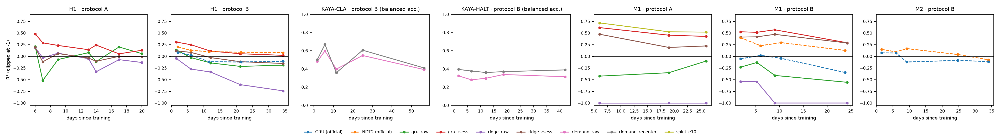

# decay_bench: how fast do neural decoders decay across days?

[](https://github.com/YihengLi-1/decay-bench/actions/workflows/tests.yml)

Intracortical decoders lose accuracy from one recording day to the next, which is why people with implanted
BCIs recalibrate so often. New models (pretrained transformers, permutation-invariant decoders, test-time
adaptation) are often reported to be more stable, but stability is rarely measured as a function of the number
of days since training, and rarely against the simplest fix: re-normalizing each session's channels with a few
unlabeled trials.

decay_bench reports, for every decoder, **R² as a function of days since training** and the **decay slope**
(R² against log2(1 + days), with a bootstrap CI), next to a **per-session normalization control**. It runs on
the public [FALCON benchmark](https://snel-repo.github.io/falcon/) (Karpowicz et al., NeurIPS 2024) datasets.

See [LEADERBOARD.md](LEADERBOARD.md). The confirmatory analysis is pre-registered in
[ANALYSIS_PLAN.md](ANALYSIS_PLAN.md); everything currently on the leaderboard is exploratory.
Pretrained entries carry a per-dataset overlap mark (was the test subject in pretraining?): [OVERLAP.md](OVERLAP.md).



## Protocols

Both use only FALCON's public calibration files: held-in calibration (training days) and held-out calibration
(later days, labeled). A test recording is split at a trial boundary near its middle; the first part is
unlabeled context (a decoder may use its neural data, never its labels), the second part is scored with
variance-weighted R² on the bins the FALCON evaluator scores.

- **A, later sessions**: train on all held-in recordings, score each held-out recording. Gap = days since the
  last training day. Answers "how does a decoder trained once hold up?".
- **B, cross-session matrix**: for each held-in day, train on that day only and score every other recording.
  Gap = |days| between training and test day. Many more pairs, so the slope is fitted per training day and the
  bootstrap resamples training days.

The FALCON authors' single-session NDT2 and GRU results on the private test split are included as protocol B
"official" rows ([official/](official/)); they use different test data and no context split, so compare their
slopes with each other, not their R² with local rows.

## Entries

| entry | what it is |
|---|---|
| `ridge_raw` | ridge on smoothed, lagged spike counts, z-scored with training statistics (no adaptation) |
| `ridge_zsess` | the same decoder, z-scored per test recording from its unlabeled context: the normalization control |
| `spint_*` | a trained [SPINT](https://github.com/shlizee/SPINT) checkpoint, adapted per recording from its context trials without gradients (protocol A only, since it is trained on all held-in data) |
| `NDT2 (official)`, `GRU (official)` | FALCON authors' cross-session results |

## Adding a decoder

A decoder is any object with

```python
fit(train_recordings)            # list of decay_bench.data.Recording
predict(recording, h) -> array   # predictions for bins h: of recording; bins < h are unlabeled context
```

Register it in `decay_bench/models.py` (`MODELS`), then

```bash
python -m decay_bench.run --task m1 --protocol A --model your_model
python -m decay_bench.run --leaderboard
```

Please also report the decoder with and without your normalization or adaptation step, so the gain over
per-session z-scoring is visible.

### Models that need their own environment

Some models only run in their own codebase (POYO in torch_brain, NDT3 in its repository). For those, write a
small entry script that loads the recordings with `decay_bench.data.load_task`, scores them with
`decay_bench.protocols.r2` on the same split (`Recording.split_index()`), and writes
`results/{task}_{protocol}_{name}.json` with the fields `task`, `protocol`, `model`, `source` and `rows`
(one `{"train", "test", "gap", "r2"}` per scored recording). `python -m decay_bench.run --leaderboard` picks it up
and recomputes the summary from the rows. [`poyo_entry.py`](poyo_entry.py) and [`ndt3_entry.py`](ndt3_entry.py)
are worked examples; a pull request with your entry script and its results file is the easiest way to add a model.

## Setup

```bash
pip install -e ".[falcon]"
dandi download https://dandiarchive.org/dandiset/000941/draft   # M1 (0.3 GB); H1 is 000954 (0.1 GB)
export FALCON_DATA=/path/to/dandisets
python -m pytest tests
```

Data loading is the official `falcon_challenge.dataloaders.load_nwb`, cached as `.npz`.

## Caveats

- FALCON has 3 (M1) to 7 (H1) held-out days per subject, and 4–6 held-in days. Curves are coarse and CIs wide;
  treat differences in slope as hypotheses until they replicate across tasks.
- Held-out calibration files are short (M1: 10 trials), so the context half is small. This favours methods that
  adapt from little data, which is the realistic setting.
- M2 is not included yet: its NWB files carry 30 kHz broadband data (~16 GB).
